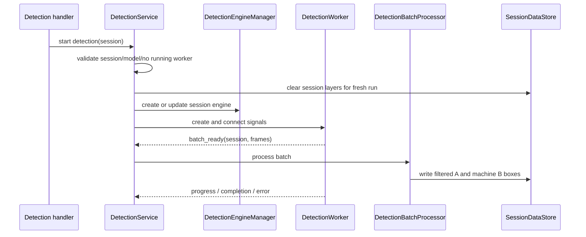

# Detection services

Source: `src/app/application/services/detection`

Detection is split into a short current-frame operation and a video-wide
background workflow. The Application service chooses the engine for a session,
checks that a model is configured, connects worker signals, and processes each
result batch into session layers. It does not implement the model or decode
frames itself.

## Video-wide detection

The service rejects a second concurrent detection run for a session and
requires a selected model. Starting a new run clears the session's layers,
creates or updates its per-session engine, then starts a worker. Batches arrive
through Qt signals and are processed on the Application side. The worker
maintains a thread-safe cache, but the batch processor is what writes the
authoritative annotation layers.

For each frame, the processor maps model results to box values and applies the
session's label and confidence filters. Selected machine output is recorded in
Layer A, and cloned machine boxes refresh Layer B. Existing manual boxes in B
are preserved by the store's replacement operation. Frames that already have
A boxes are skipped rather than overwritten. This keeps source inference
separate from user edits; see the [layer model](../../domain/video.md).

## Current-frame detection and layer operations

`DetectionExecutionService` handles one frame through the engine manager and
uses the current session frame. It writes selected results into the same
A/B model rather than introducing an alternate one-frame-only storage path.
The layer service owns editing and filtering behavior for Layer B. Import and
export collaborators handle annotation interchange (JSON/CSV), which is
distinct from rendering a blurred video.

The [detection worker](../../infrastructure/detection/worker.md) explains frame
reads, batches, and cooperative cancellation. Model selection and inference
are implemented in [detection infrastructure](../../infrastructure/detection/index.md)
and the [engine guide](../../infrastructure/detection/engine.md).
