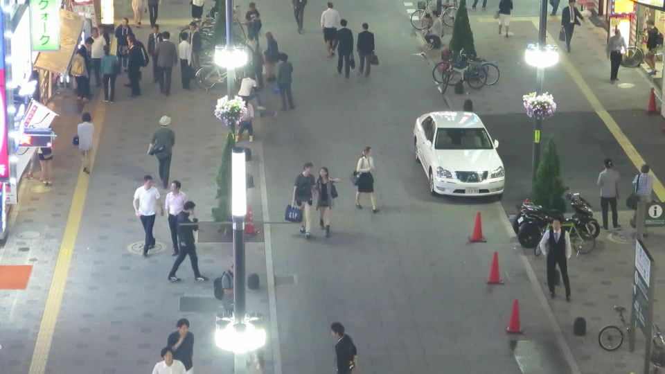
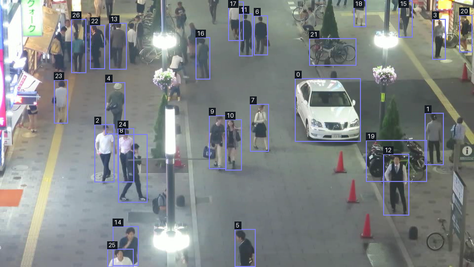

# Detection engine

Source: `src/app/infrastructure/detection/engine`

An image is a grid of pixels. A detection model guesses which objects appear in
that grid and where they are. **`DetectionEngine` gives the rest of Blurzy one
way to ask that question:** supply one image and receive a list of detected
objects.

The engine is a small coordinator, not the neural network. It loads one selected
model wrapper and delegates work to it. The wrapper knows how to talk to its
provider library and translate predictions into Blurzy's common result format.

## One image in, common results out


Solid arrows show the image/prediction/result flow. The dashed arrow shows a
choice made when loading: **YOLO, TorchVision, MTCNN, and Dummy are alternatives,
not a sequence of models run on every image.**

| Part | In plain language |
| --- | --- |
| `DetectionEngine` | Keeps the chosen model and forwards each image to it |
| `load_detection_model()` | Looks up a registered model name and creates its wrapper |
| `BaseDetectionModel` | The shared contract: a wrapper accepts an image and returns detections |
| Provider wrapper | Handles library-specific loading and inference |
| Provider library | Runs the trained neural network and produces raw predictions |
| Mapper | Filters and translates provider output into common detection records |

For example, YOLO produces its own boxes, class numbers, and confidence values.
`YoloDetectionMapper` turns class numbers into labels, converts coordinates to
integer pixels, and creates `DetectionResult` records. **The engine itself does
not perform that conversion:** it returns the wrapper's list directly.

That stable boundary keeps provider-specific result objects out of callers.
Switching providers does not require each caller to learn a new output format,
but it does not make providers equivalent: a face detector and a general object
detector do not find the same things. See [Detection models](model.md) for that
integration boundary and the [generated API reference](../../../reference/api/index.md)
for exact provider contracts.

## Load once, then process images


Solid arrows show the successful call order; dashed arrows show error paths.
The inference settings and caught-error branches in this diagram describe
**YOLO specifically**, not every provider.

1. **Construct:** `DetectionEngine("YOLOv8n")` asks the loader for the wrapper.
   The wrapper loads the model weights (the trained parameters) during
   construction.
2. **Call:** `engine.detect(frame)` forwards the pixel array to
   `self._model.detect(frame, None)`. `None` means the engine requests no
   label restriction.
3. **Predict and translate:** the wrapper calls the provider and maps its
   output. YOLO uses a confidence threshold of `0.25` and an NMS IoU threshold
   of `0.45`. NMS suppresses competing overlapping predictions; IoU measures
   the overlap between their boxes.
4. **Return:** the caller receives `list[DetectionResult]`, which can be empty.
   The loaded wrapper is reused for the next image.

```python
import numpy as np
from PIL import Image
from app.infrastructure.detection.engine.detection_engine import DetectionEngine

with Image.open("docs/assets/api/detection_engine/snapshot-original.png") as image:
    frame = np.array(image.convert("RGB"))

engine = DetectionEngine("YOLOv8n")
detections = engine.detect(frame)
```

This mirrors the application's RGB image path, including the current YOLO
channel-order limitation described below. It is not a recommendation to treat
RGB and BGR as interchangeable.

## A real image through the engine

Here is the supplied street-scene snapshot, before any annotations:



The example generator called **`DetectionEngine("YOLOv8n").detect(frame)`**, not
Ultralytics directly. On this image it returned **27 records**:

| Label | Returned detections |
| --- | ---: |
| `person` | 24 |
| `motorcycle` | 2 |
| `car` | 1 |

The same returned records were used to draw these boxes:



The numeric tags are short record IDs: **`0` means `yolo-0`**, for example.
Short tags avoid covering this crowded scene with long labels. All classes are
retained, and the downloadable data contains the label and score for every box.
Some tags overlap and some objects are missed; this is model output, not a
ground-truth annotation or a promise that every visible person was detected.

### Reading one result

These are actual records from this run, with scores rounded only for display:

| Record | Label | Confidence | Box `(x1, y1, x2, y2)` |
| --- | --- | ---: | --- |
| `yolo-0` | `car` | 0.888 | `(597, 158, 730, 286)` |
| `yolo-1` | `person` | 0.842 | `(860, 228, 898, 333)` |
| `yolo-2` | `person` | 0.812 | `(191, 251, 231, 368)` |

The image origin is its top-left corner: x increases rightward and y increases
downward. A box gives its top-left and bottom-right pixel coordinates in the
original **960 x 540** image. Confidence is the model's score, not a guarantee
that a prediction is correct. The mapper's `yolo-N` IDs are local to its output;
they are **not tracking IDs** and do not identify the same person across frames.
`color_hex` is presentation metadata, not another model prediction. See
[Bounding box](../../domain/bounding-box.md) and
[Detection domain values](../../domain/detection.md).

[Download all results and run metadata (JSON)](../../../assets/api/detection_engine/snapshot-results.json).
The file includes full-precision scores, coordinates, counts, image and weights
hashes, package versions, and input/settings details.

### Reproduce the example

From the repository root, with the application dependencies installed and the
existing **`yolov8n.pt` weights available locally**, run:

```powershell
python scripts\generate_detection_engine_example.py
```

The default input is the published original PNG. To regenerate from the
supplied root-level file instead:

```powershell
python scripts\generate_detection_engine_example.py --input MOT17-04-SDP-snapshot.png
```

Generation is opt-in, not part of the documentation build. The script refuses
missing local weights, warnings, empty results for this example, and invalid
boxes, rather than publishing a success-shaped failure. It writes both PNGs
and the JSON to `docs/assets/api/detection_engine/`.

The recorded run used Python `3.14.3`, Ultralytics `8.4.177`, Torch `2.14.1`,
confidence `0.25`, IoU `0.45`, no class restriction, and otherwise installed
provider defaults. Different weights, versions, hardware, or provider defaults
can change results. The JSON's `packages` field reports installed distribution
metadata, which can differ from the source checkout's project version.

!!! warning "Current input-channel limitation"

    Blurzy's video reader produces RGB arrays, and the YOLO wrapper forwards
    arrays unchanged. The installed Ultralytics predictor expects BGR NumPy
    input and reverses the channels internally. This example deliberately passes
    RGB to match the current application path, so the provider sees swapped
    red/blue channels. These results demonstrate existing behavior, not a
    corrected color pipeline or an accuracy benchmark. Other wrappers have
    different preprocessing; the common interface alone does not solve this.

!!! note "Image provenance"

    The input was supplied as `MOT17-04-SDP-snapshot.png`. Its exact origin and
    redistribution permission have not been verified. The filename is not a
    license grant; resolve attribution and permission before public distribution.

## What prevents a failure from breaking the workflow?

The shared interface avoids incompatible result shapes in callers, but it is
**not a universal error boundary**. Current behavior depends on where a failure
occurs:

| Situation | Current behavior |
| --- | --- |
| Unknown registered name | Loader raises `DetectionModelError` |
| YOLO dependency or weights cannot load | YOLO loader raises `DetectionModelError` |
| YOLO inference raises an exception | Wrapper logs a warning and returns `[]` |
| One YOLO prediction cannot be mapped | Mapper logs a warning and skips that item |
| Other exception reaches the engine | Engine does not catch it |

Consequently, `[]` alone cannot tell a caller whether no objects were found or
YOLO inference failed; logs matter. The [detection worker](worker.md) has its own
outer error reporting for exceptions that reach its video loop. Do not infer
that every provider has YOLO's recovery behavior.

`set_model()` also deserves care: it updates the stored name **before** loading
the replacement. If loading fails, the previous wrapper remains but the name
has already changed. Switching is not an atomic rollback operation; callers
must handle the exception rather than assume a successful switch.

## Where the engine stops

The engine handles one image per call. It does not iterate a video, assign
persistent tracking identities, draw boxes, or blur pixels. The annotated image
above is drawn by the example generator, not by `DetectionEngine`.

The application factory wraps the engine in an adapter exposing the application
interface. The Application manager owns engines per session and coordinates
model selection; the worker reads frames and emits batches. See
[Application managers](../../application/managers.md) and
[Detection worker](worker.md) for those responsibilities.

Supported names remain in
`src/app/infrastructure/detection/model/names.py`; the generated engine API
catalog reads those registries. This guide does not maintain a duplicate list.

## Maintain these illustrations

Editable sources and rendered images live together in
`docs/assets/api/detection_engine/`. With the D2 CLI on PATH, regenerate both
diagrams from the repository root:

```powershell
foreach ($name in @('flow', 'lifecycle')) {
    d2 --theme 0 --pad 24 "docs\assets\api\detection_engine\$name.d2" "docs\assets\api\detection_engine\$name-light.svg"
    d2 --theme 200 --pad 24 "docs\assets\api\detection_engine\$name.d2" "docs\assets\api\detection_engine\$name-dark.svg"
}
```

Follow [Writing architecture guides](../../../development/architecture-documentation.md)
for the shared authoring, asset, and evidence conventions.