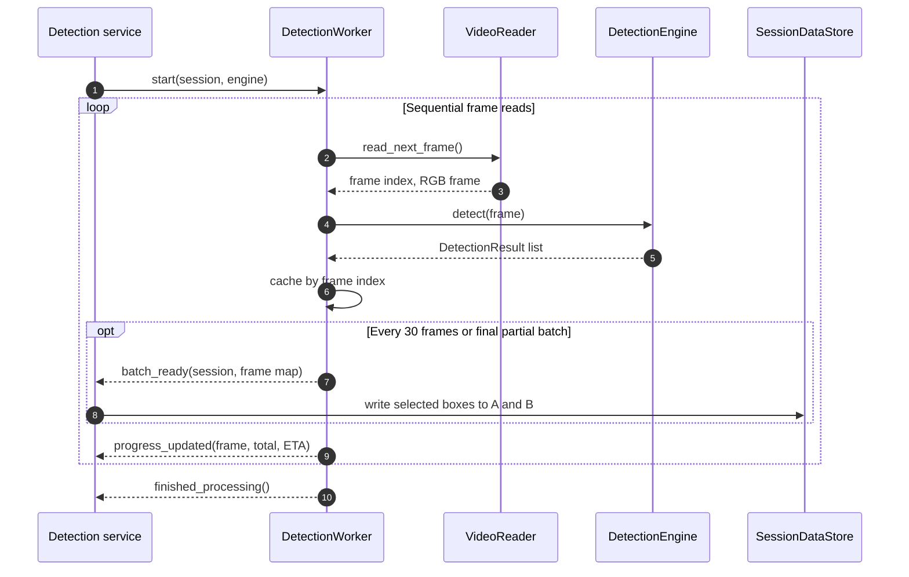

# Detection worker

Source: `src/app/infrastructure/detection/worker`

`DetectionWorker` turns one video's decoded frames into a frame-indexed cache
of inference results without blocking Qt's event loop. Its job is deliberately
narrow: read frames in order, call the selected
[detection engine](engine.md), cache each response, and publish batches and
progress through Qt signals. It does not choose annotation layers or edit
boxes; the [Application detection service](../../application/services/detection.md)
owns those decisions.

## From video frame to annotation layers

For each decoded frame, the worker uses the reader's actual frame index rather
than assuming that a read always corresponds to an independently calculated
position. Results are cached under a mutex so the Application side can read
one frame or take a snapshot while processing continues. Batches contain up to
30 frames; the final smaller batch is flushed when the video ends or a stop is
requested.

The batch processor maps inference values to box view models, applies the
session's selected labels and minimum detection confidence, then stores the
selected output in **A** and machine-generated copies in **B**. Existing A data
for a frame is not overwritten. When B is refreshed, manual boxes are retained
while machine-produced boxes are replaced. Thus worker output stays separate
from the editable review layer; see [detection layers](../../domain/video.md).

## Progress, failures, and cancellation

The worker reports frame progress (including an ETA estimate), emits an error
message if frame reading or a non-recovered inference call fails, and always
emits its completion signal from cleanup. A provider may itself convert an
inference failure into an empty result list, so callers must not assume every
empty list means the image contained no objects; the engine guide details this
provider-specific behavior.

`stop()` is cooperative: it is checked between frame iterations and cannot
interrupt a model call already in progress. On an early stop, already emitted
work remains available and the current partial batch is still flushed. The
service/manager owns worker lifecycle and signal connections; the worker never
accesses Qt widgets directly.
