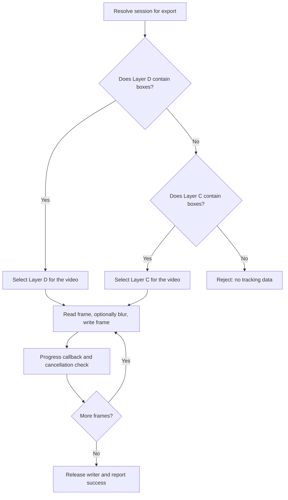

# Export infrastructure

Source: `src/app/infrastructure/export`

Video output is rendered by the Application `ExportService`; infrastructure
workers keep that expensive frame loop off the UI event loop and relay progress
and outcomes. Annotation interchange (JSON/CSV) is a separate data workflow,
not video rendering.

Arrows show selection and the normal render path. Layer selection is made for
the export as a whole: an empty frame in D does not trigger a per-frame fallback
to C. Exceptions and cancellation leave the render loop through cleanup.

## One-session export

`ExportWorker` calls the Application service for one session and destination.
The service prefers editable Layer D when it contains boxes and falls back to
machine Layer C when D is empty. For each frame, it reads the source RGB image,
converts it for OpenCV writing, applies masked blur to the selected boxes when
render blur is enabled, writes the frame, and reports progress. The output is
an MP4 using the source dimensions and frame rate. Preview-only styling does
not control this render path.

Cancellation is cooperative: `stop()` sets a flag that is checked by the
service's next progress callback. The callback raises the worker's
`ExportCancelled` signal path; it cannot interrupt the current read, blur, or
write operation in the middle of a frame. The worker distinguishes success,
cancel, and error signals, then always signals that processing finished.

## Multi-session export

`ExportAllWorker` processes sessions sequentially. For each session, it checks
whether Layer A exists and runs detection if needed; then it checks Layer C
and runs tracking if needed. If configured source B is empty while A has
detections, the batch workflow falls back to A. It then checks export
readiness, constructs a filename from prefix, video basename, and suffix, and
exports before moving to the next session.

The batch worker reports per-session start/success/failure, overall session
progress, and per-frame export progress. A stop request can stop active
detection or tracking workers and prevents subsequent stages/sessions. If
export is already rendering, cancellation is observed at its progress
callback; this differs from interrupting an individual frame operation.

!!! warning "A stop request is not a rollback"

    Both export paths observe cancellation at a progress callback, not halfway
    through a frame operation. The writer is released, but cancellation does
    not guarantee removal of a partially written output file.

| Workflow | Work unit | Progress | Terminal outcome |
| --- | --- | --- | --- |
| `ExportWorker` | One session | Frame count | Success, cancellation, or error; always processing-finished |
| `ExportAllWorker` | Sequential sessions with detect/track preparation as needed | Session count plus frame count for the current export | Per-session success/failure and optional batch cancellation |

The four layers and export fallback are described in
[Video layers](../domain/video.md). For exact blur composition and rendering
ownership, see [Application export](../application/services/index.md) and
[tracking infrastructure](tracking.md).
