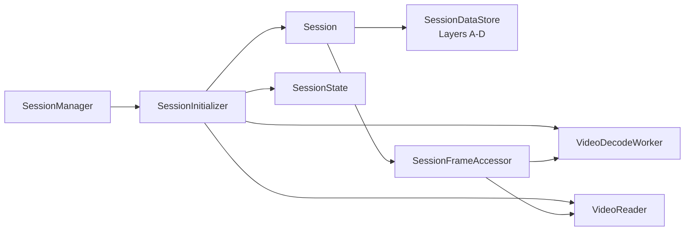

# Session infrastructure

Source: `src/app/infrastructure/session`

An infrastructure `Session` is the live runtime for one open video. It brings
together a `SessionId`, domain `SessionState`, annotation storage, reader, and
worker references. It is intentionally created as a lightweight shell first;
the Application's `SessionInitializer` opens the media, builds state from
reader metadata, starts a decode worker, and attaches those collaborators.
`SessionManager` owns the collection of open sessions and chooses the active one.

## Runtime responsibilities

The diagram's arrows show construction/attachment and collaborator references,
not a sequence of frame reads.

| Collaborator | Owns or coordinates | Does not own |
| --- | --- | --- |
| `SessionState` | Metadata, playback, current frame, settings, annotation identity counter | Decoder, workers, annotation layers |
| `SessionDataStore` | A/B/C/D storage and synchronized machine/manual box operations | Video pixels or project-file writing |
| `SessionFrameAccessor` | Current/next/previous/indexed frame retrieval via cache and seek | Inference or tracking association |
| Reader and workers | Media I/O and long-running processing | Direct Qt widget updates |

!!! info "Session state is not the entire session"

    A domain `SessionState` can describe playback and settings, but it cannot
    supply annotations or decode the next frame on its own. The infrastructure
    `Session` assembles those runtime collaborators around it.

When a session closes, it requests its detection, tracking, and decode workers
to stop and closes its reader. The owning manager removes it from the open
session collection and updates active-session selection. Project payload
conversion is supported by the store, but file persistence belongs to
[ProjectStore](project.md), while project reopen/restore decisions belong to
the Application project workflow.

For state that is serializable and independent from runtime resources, see
[Session domain](../domain/session.md). Decoding and buffering are explained in
[Video infrastructure](video.md).
