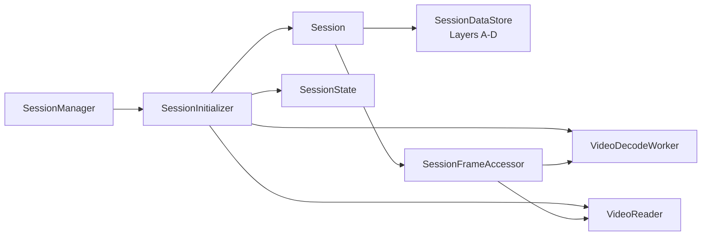

# Session infrastructure

Source: `src/app/infrastructure/session`

An infrastructure `Session` is the live runtime for one open video. It brings
together a `SessionId`, domain `SessionState`, annotation storage, reader, and
worker references. It is intentionally created as a lightweight shell first;
the Application's `SessionInitializer` opens the media, builds state from
reader metadata, starts a decode worker, and attaches those collaborators.
`SessionManager` owns the collection of open sessions and chooses the active one.

## Runtime responsibilities

- **`SessionState`** holds video metadata, playback position/status, current
  frame data, settings, and per-session annotation identity state. It does not
  own workers or decode pixels.
- **`SessionDataStore`** owns the A/B/C/D annotation layers and synchronizes
  access to the mutable layer structures. Its bulk replacement operations
  distinguish machine-generated boxes from manual edits.
- **`SessionFrameAccessor`** serves current, next, previous, and indexed frames.
  It first uses the decode worker's ring buffer and coordinates a seek/read
  fallback when the requested frame is not cached.
- **Reader and workers** perform actual media I/O and long-running processing;
  the session exposes access and lifecycle methods without moving that work
  onto the UI thread.

When a session closes, it requests its detection, tracking, and decode workers
to stop and closes its reader. The owning manager removes it from the open
session collection and updates active-session selection. Project payload
conversion is supported by the store, but file persistence belongs to
[ProjectStore](project.md), while project reopen/restore decisions belong to
the Application project workflow.

For state that is serializable and independent from runtime resources, see
[Session domain](../domain/session.md). Decoding and buffering are explained in
[Video infrastructure](video.md).
