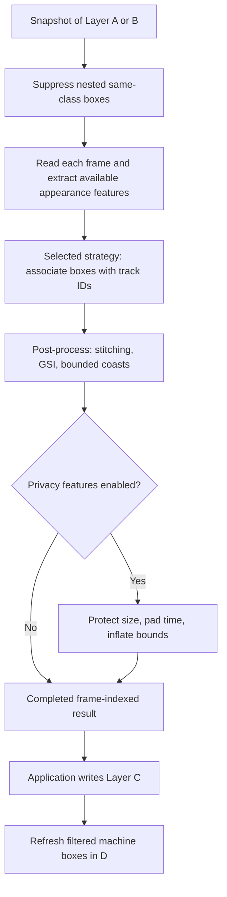

# Tracking infrastructure

Source: `src/app/infrastructure/tracking`

Tracking turns detections from one selected layer into frame-indexed subject
tracks. The worker snapshots its input, processes frames on a background Qt
thread, then runs an offline refinement pass before exposing results to
Application services. Application validates the selected input (A or B) and
places the resulting machine output in C while maintaining editable D; see
[Tracking services](../application/services/tracking.md).

Arrows show processing order. The per-frame association loop finishes before
offline refinement begins; Layer D is updated by Application, not by the worker.

## The tracking pass

Before association, the worker suppresses nested same-class duplicates within
each frame. Containment is measured against the smaller box's area; suppressed
boxes are unioned into the retained bounds to preserve their visible coverage.
Each strategy then receives the boxes in frame order. Detection-backed outputs
are distinguished from coasted predictions with observation metadata, so later
processing can use actual observations without mistaking a prediction for one.

| Strategy | Association evidence | Appearance used in association? |
| --- | --- | --- |
| Hungarian IoU | Predicted box overlap | No |
| ByteTrack | Motion and strong/weak detection groups | No |
| DeepSORT | Age-ordered motion/overlap and appearance memory | When available |
| BoT-SORT | Kalman motion, confidence groups, and appearance | When available |
| Dummy | No association: copies detections | No |

### Follow one strategy

=== "Hungarian IoU"

    **A motion/overlap baseline.** Predict each active track using its last
    centroid velocity, build a track-to-detection overlap (IoU) matrix, and
    solve a global Hungarian assignment. Reject matches below the configured
    IoU threshold.

    Unmatched detections start tracks. Unmatched tracks coast and lose
    confidence until they fall below the retention floor. Their output boxes
    are explicitly marked as predictions, not new detector observations.

=== "ByteTrack"

    **Use weak detections to recover an existing identity.** Blurzy wraps
    Ultralytics' ByteTrack, adapts its confidence split to each frame, and
    associates stronger detections before trying the weaker group.

    The adapter maps provider output into Blurzy's common box/ID format. A
    bounded motion-based fallback reconciles IDs when library output cannot
    continue an identity safely. Lower-confidence recovery cannot bring back a
    detection that was already removed from the selected input layer.

=== "DeepSORT"

    **Give recent tracks first claim, then try appearance recovery.**
    Confirmed tracks are matched in age order using motion/IoU and appearance
    cost. A wider-radius recovery pass considers unambiguous appearance
    matches; tentative tracks then use IoU matching.

    Normalized embeddings form per-track appearance memory. Only isolated
    observations update that memory, reducing contamination from overlapping
    subjects. Without valid appearance data, the appearance recovery pass
    cannot help.

=== "BoT-SORT"

    **Predict motion, then associate in stages.** A Kalman filter predicts
    center, width, and height. High-confidence detections use overlap with
    gated appearance evidence, followed by conservative appearance
    re-identification for remaining tracks.

    Lower-confidence detections then provide motion-only recovery. Appearance
    memory updates use isolated high-confidence observations; missing features
    leave the strategy operating on motion/overlap rather than invented Re-ID.

=== "Dummy"

    **Pass through boxes without persistent association.** The strategy copies
    detections and retags them as tracking output. Use it for debugging the
    pipeline, not as a method for maintaining subject identity.

Hungarian, DeepSORT, and BoT-SORT create boxes for still-active unmatched
tracks with `detection_backed=False` and an increasing `time_since_update`.
ByteTrack also normalizes backend/coast outputs into that metadata. Downstream
post-processing uses this distinction to avoid treating a prediction as a new
observation.

DeepSORT and BoT-SORT use frame-derived appearance embeddings when a local
video can be read. Embeddings are aligned to the input boxes and only valid
crops contribute. Linking combines appearance with class, projected geometry,
box scale, and ambiguity checks; it does not equate similar appearance with
identity by itself. Configured embedding dimensions are 128, 256, or 512. If
the session path is missing or is not a file, tracking continues without
frame-derived appearance; an existing but unreadable file is a worker error.

## Offline stitching and GSI

With offline stitching enabled (the default), the post-processor extracts
continuous runs of observed boxes into tracklets. It considers later
same-class fragments with a gap no longer than the configured maximum (25
frames by default). Candidate links must pass projected geometry and scale
checks, and the global assignment is rejected when a competing link is too
ambiguous. Appearance embeddings can strengthen or reject a candidate.

!!! example "One gap, two possible outcomes"

    Suppose one fragment ends at frame 10 and a second begins at frame 14.
    Frames 11-13 are missing. The following is an illustrative timeline, not
    recorded inference output.

    | Frame | Input evidence | If the link is accepted |
    | --- | --- | --- |
    | 10 | Last observation of the earlier fragment | Retain the observed box |
    | 11-13 | No observation for this subject | Generate three GSI boxes under the earlier identity |
    | 14 | First observation of the later fragment | Retain the observation under the linked identity |

    If geometry, class, appearance, or ambiguity checks reject the link, GSI
    does not fill this gap. The separate, bounded coast policy may still add
    predictions after the earlier fragment.

For an accepted link, the same identity is carried across the gap and missing
boxes are interpolated from both endpoints. Each endpoint box is projected
toward the missing frame using its local motion estimate; Gaussian weights
make nearer endpoint estimates contribute more:

$$
w_L = \exp\left(-\frac{d_L^2}{2\sigma^2}\right), \qquad
w_R = \exp\left(-\frac{d_R^2}{2\sigma^2}\right)
$$

$$
B_t = \frac{w_L\widehat{B}_{L,t}+w_R\widehat{B}_{R,t}}{w_L+w_R}
$$

Here $d_L$ and $d_R$ are frame distances to the observed endpoints, $\sigma$
is the configured GSI smoothness, and each $\widehat{B}$ is that endpoint's
projected `xyxy` box. This is an offline operation: it uses a later observation
to refine earlier missing frames, so it is not a live prediction.

| Post-processing mode | Gap handling | Unbridged tails |
| --- | --- | --- |
| Offline stitching enabled | Link accepted fragments and fill their gaps with GSI | Up to six frames, with twice the configured confidence decay |
| Offline stitching disabled | No cross-gap links or GSI; retain causal strategy coasts | Normal confidence decay, subject to the retention floor |

!!! note "Interpolation needs future evidence"

    GSI uses a later observation to refine earlier missing frames. It is an
    offline reconstruction, not a live prediction or a new detector observation.

## Privacy-oriented coverage controls

When enabled, privacy post-processing runs after track stitching:

| Control | What changes | Why it can help |
| --- | --- | --- |
| Shrink resistance | Expand immediately when boxes grow; damp contraction of the running size envelope | A partial-body observation need not abruptly expose the rest of a subject |
| Pre/post padding | Extend coverage around the first/last observation using damped endpoint motion | Cover short delays at the start/end of observed tracks |
| Safety padding | Enlarge the box and clamp to known frame bounds | Add spatial margin around uncertain edges |

Temporal padding is configured in seconds and converted using the video frame
rate. Generated padding confidence declines toward the configured floor.
!!! warning "Coverage is not detection completeness"

    These controls enlarge or extend existing tracks. They cannot guarantee
    that every subject was detected or that generated boxes are ground truth.

Defaults are stitching enabled, a maximum gap of 25 frames, GSI smoothness 10,
shrink resistance 0.85, 0.5 seconds of pre- and post-detection padding, and
10% safety padding. Settings validation allows gaps up to 60 frames, padding
up to five seconds on either side, and safety padding up to 50%.

??? example "Interpret the padding units"

    At 30 FPS, 0.5 seconds corresponds to 15 frames on each configured side of
    the observed track, limited by the video bounds and projection checks.
    A 100 x 200 pixel box with 10% safety padding grows to approximately
    110 x 220 pixels before frame-edge clipping: the added width and height
    are split evenly across opposite edges.

The worker returns frame-indexed results only after processing completes;
Application writes those results to C and seeds/refreshes machine boxes in D
while preserving user-created D annotations. See the [tracking settings](../domain/tracking.md)
and [four annotation layers](../domain/video.md).
