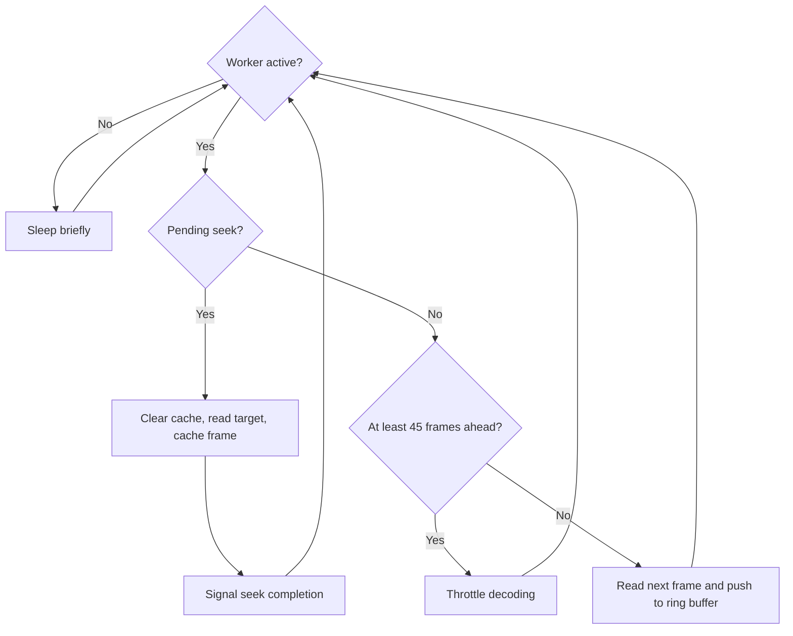

# Video infrastructure

Source: `src/app/infrastructure/video`

The video path has two collaborators with different jobs. `VideoReader`
performs PyAV container/stream access and produces RGB frames; `VideoDecodeWorker`
reads ahead into a bounded ring buffer so normal playback can fetch frames
without waiting for each decode. Both are attached to a runtime
[Session](session.md), but a `VideoReader` itself is not thread-safe and each
decoding thread needs its own instance.

## Reader: metadata and frame access

Opening a reader selects a video stream and constructs domain metadata such as
dimensions, frame rate, frame count, and duration. It can read sequentially
(the first sequential frame is index 0) or seek to a requested index. Rotation
metadata is detected from stream metadata/side data with a container fallback;
user-requested rotation is applied on top. The final RGB frame is rotated into
the presentation orientation, with width/height adjusted for quarter turns.

Sequential reads suit playback and full-video processing. Indexed reads serve
scrubbing and frame retrieval. A read failure is not represented as a valid
blank image: stream exhaustion and invalid/read failures use explicit
exceptions or a missing-frame result depending on the operation.

## Decode-ahead worker: playback cache

The decode worker sleeps while inactive. Once activated, it services a pending
hard-seek request first, clears the ring buffer, decodes that indexed frame,
caches it, and signals seek completion. Otherwise it decodes sequentially
until it is roughly 45 frames ahead of the playback playhead, then throttles.
The ring buffer retains up to 90 frames; deactivation clears it to release the
memory used by cached images.

Arrows show the normal decode loop, not its exception paths. Seek requests are
serviced while the worker is active; requesting a seek does not itself activate
an inactive worker.

| Resource or limit | Current value | Purpose |
| --- | --- | --- |
| Ring buffer capacity | 90 frames | Bound the number of cached images |
| Decode-ahead threshold | 45 frames beyond the playhead | Throttle when playback already has enough lookahead |
| Deactivation | Clear the ring buffer | Release cached frame memory for inactive sessions |

The Application decode manager activates the new session at its current frame
and deactivates the previous session during an active-session switch. The
session frame accessor reads cached frames when available and requests a seek
when a scrub target is outside the cache. The design keeps decode off the UI
thread while allowing the UI to remain responsive during playback and scrubbing.

The reader and worker are created by [session initialization](../application/managers.md)
and closed during [session teardown](session.md). Playback state and the
bounded buffer type belong to the [video domain](../domain/video.md).

!!! tip "Do not confuse the caches"

    Playback caches decoded **pixels**. The detection worker caches
    **inference results**, and the session store holds **annotations**.
    Clearing playback's ring buffer does not delete Layers A-D.
