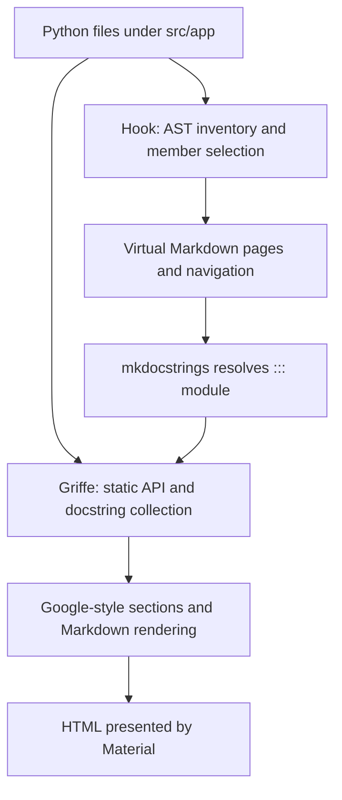

# Reference documentation

Blurzy maintains two complementary references. **Architecture** is the
beginner-friendly, visual explanation of responsibilities, workflows, and design.
Follow [Writing architecture guides](architecture-documentation.md) for shared
authoring and asset conventions.
**API reference** is generated from Python source on every build. This avoids
maintaining a second copy of module inventories and signatures, but does not
make behavioral explanations automatically correct.

## From source to page



## Reading the hook

This file is a **MkDocs build hook**, not a standalone script that writes
Markdown files. `mkdocs.yml` registers it under `hooks`; MkDocs loads it as
part of the build and calls its hook functions at specific points. The hook
uses the directory containing `mkdocs.yml` as the project root.

The important lifecycle is:

1. **Collect files and shape the menus (`on_files`)**: scan `src/app`, parse
   Python declarations with `ast`, add virtual Markdown pages to MkDocs' in-memory
   file collection, and replace the two reference navigation trees. It also
   validates package-note `Source:` mappings, adds their generated API links to
   the build-time page copy, and reserves `reference/api` for generated pages.
2. **Render each API page**: MkDocs processes the generated `::: app...`
   directives with mkdocstrings. Its Python handler uses Griffe to statically
   read source and docstrings; the hook itself does not render the API HTML.
3. **Finish and preview**: `on_page_context` removes edit links from virtual
   pages; `on_post_page` turns `api-asset:` references into depth-correct URLs
   and checks the asset exists. During `mkdocs serve`, `on_serve` watches
   `src/app` so source changes trigger rebuilds.

The script's helpers separate those steps:

| Code | Responsibility |
| --- | --- |
| `discover_modules`, `children`, `api_navigation`, `note_navigation` | Map source files and editorial notes into stable page paths and menus |
| `local_members`, `is_api_assignment` | Select module-level API names using syntax and naming conventions, without evaluating code |
| `module_page`, `detection_model_catalog`, `resolve_export` | Compose virtual page Markdown, include the model catalog, and link package re-exports to their definitions |
| `on_files` | Connect discovery to MkDocs: validate notes, inject generated files, set navigation, and hide the app wrapper from the menu |
| `on_page_context`, `on_post_page`, `on_serve` | Apply generated-page edit-link, asset-URL, and live-reload behavior |

To change API descriptions, edit Python docstrings. To change package
responsibility notes, edit the authored Markdown under `docs/architecture/`. Edit
the hook only when generation, selection, links, assets, or navigation logic
needs to change; never add authored Markdown under `docs/reference/api/`.

### 1. Discover modules and choose members

The hook in `scripts/docs_reference.py` scans `src/app` deterministically.
`discover_modules()` maps a module such as
`src/app/domain/video/metadata.py` to `reference/api/app/domain/video/metadata/index.md`.
A package's `__init__.py` maps to its package index. A module named `index.py`
gets its own directory, so it cannot collide with that package index.

Python's `ast.parse()` reads declarations without executing imports or
initializers. `local_members()` selects defining-module API members; it does
not turn method bodies into prose. Functions, classes, constants, and type
aliases become candidates. Runtime objects such as `logger = get_logger(...)`
are implementation wiring, not API declarations.

### 2. Create virtual Markdown

`module_page()` creates a readable title, qualified-module context, a source
link, and a mkdocstrings directive. For example:

```python
"""Tools for labeling frames."""

from app.shared.logging_cfg import get_logger

DEFAULT_LABEL = "person"
logger = get_logger("Example")

def label_frame(frame_index: int, label: str = DEFAULT_LABEL) -> str:
    """Build a display label for a frame.

    Args:
        frame_index: Zero-based frame index.
        label: Text shown beside the frame.

    Returns:
        A display label containing the index and text.
    """
    return f"{frame_index}: {label}"
```

For this hypothetical `app.example` module, the generated page contains:

```markdown
::: app.example
    options:
        members: ['DEFAULT_LABEL', 'label_frame']
```

The rendered page shows the constant, `label_frame` signature with annotations
and defaults, its summary, and parameter/return sections. It does **not** show
the logger initializer or the implementation's `return` statement.

`File.generated()` stores these Markdown pages in memory for the build.
Generated Markdown is not written into `docs/reference`. HTML and search
artifacts go to `site/docs`; neither generated Markdown nor HTML is committed.

The generated `DetectionEngine` page also includes supported model names from
`app.infrastructure.detection.model.names`. The hook reads the literal
registries with AST parsing, so the catalog stays synchronized without
importing the model stack or duplicating names in documentation.

### 3. Collect API information statically

When Markdown processing encounters `::: app.example`, mkdocstrings delegates
to its Python handler. **Griffe**, that handler's source-analysis library,
collects module/class/function declarations, annotations, defaults, decorators,
properties, attributes, and docstrings.

This is distinct from the hook's AST pass: the hook chooses pages and
module-level members, while Griffe supplies structured information for rendering
those members and their public class members. `paths: [src]` locates the package.
`allow_inspection: false` disables fallback runtime imports. Documentation
builds therefore do not need Qt, model weights, or the application's ML stack.

Signals are documented as declared class attributes; no Qt object is created.
Static collection cannot infer actual signal connections or prove lifecycle
guarantees. Document those explicitly.

Keep API-example images in `docs/assets/api/` rather than embedding large SVGs
in docstrings. Reference them from rendered HTML with the `api-asset:` prefix,
for example `src="api-asset:tracking/nested-boxes.svg"`. The hook resolves that
stable asset path after mkdocstrings has rendered the docstring, calculating a
relative URL for the generated page's depth and failing the build if the asset
is missing or escapes the API asset directory.

### 4. Parse docstrings and render HTML

The configured Google-style parser recognizes sections such as `Args:`,
`Returns:`, `Raises:`, and `Attributes:`; `docstring_section_style: spacy`
renders those sections as readable tables. Descriptive text and examples then
pass through Markdown rendering. Material supplies maintained typography,
syntax highlighting, responsive navigation, color modes, and API symbol styling.
Small member-kind labels identify properties and attributes; they are metadata,
not extra API declarations.

Indentation and Markdown syntax matter. An unfenced Python comment beginning
with `#` can be interpreted as a heading after docstring parsing. Code examples
must be fenced; a successful build alone does not prove that prose looks right.

Keep all class-docstring prose, including `Layer:` and `Context:` footers,
indented to the class body, and align the closing triple quotes with the
opening quotes. An unindented footer prevents common-indent removal and can
turn the preceding prose and Google-style sections into Markdown code blocks.
Keep the additional indentation inside sections and examples intact.

Use `$...$` for inline LaTeX and `$$` on separate lines for display equations.
`pymdownx.arithmatex` preserves the math for MathJax, loaded from a pinned CDN;
rendering equations therefore requires a network connection. Use raw Python
docstrings (`r"""..."""`) when formulas contain backslashes, so commands such as
`\frac` and `\times` reach the renderer unchanged. Keep display equations
indented with their containing docstring section or admonition. Restart
`mkdocs serve` after changing configuration or hook code.

## Member-selection guidelines

| Declaration | Default treatment |
| --- | --- |
| Public classes and functions | Included, even without docstrings |
| Public methods, properties, instance attributes, signals | Included |
| Constructors | Included |
| Private names, external imported members, inherited Qt APIs | Omitted |
| Uppercase module constants, including factory-created constants | Included |
| Python `type` aliases and annotated `TypeAlias` declarations | Included |
| Conventional assignment aliases such as `Margins = tuple[int, ...]` | Included |
| Module-level runtime objects, including `logger` and `log` | Omitted |

Prefer an explicit `type` declaration for new aliases. Assignment-style aliases
are recognized syntactically from capitalized alias names and conventional
type names, subscripts, and unions; the hook does not evaluate their values. Naming conventions alone cannot
perfectly distinguish every constant, type, and runtime object.

For ambiguous cases, use `MEMBER_EXCEPTIONS` to explicitly include a
module-level name and `MEMBER_EXCLUSIONS` to omit one. Both are keyed by the
fully qualified defining module; exclusions take precedence. Keep overrides
small and deliberate, and add a regression test. Do not rename application
objects merely to make documentation filtering work.

Class-member visibility is controlled by mkdocstrings filters. An explicitly
authored directive can override visibility for a selected private API when
there is a real documentation need.

## Navigation, links, and package notes

The **API reference** menu starts at `app`'s children, without an `app` wrapper.
Its page inventory is automatic, including new root-level modules. Material's
index-page navigation makes package titles clickable without separate Overview
entries. The app package index remains reachable from the API landing page.
Existing generated URLs retain their `reference/api/app/` prefix.

Public package re-exports link through internal import chains to defining-module
pages instead of rendering duplicate API objects. Defining modules own canonical
symbol anchors. External and cyclic re-export chains are not followed into
runtime imports.

Handwritten package notes retain their Markdown and must include a valid
`Source:` mapping:

```markdown
# Video domain

Source: `../../../src/app/domain/video/`

Explain ownership and lifecycle here.
```

Source paths can be relative to the note's directory, as above for
`docs/architecture/domain/video.md`, or repository-relative (`src/app/domain/video/`).
The hook validates that package and adds an API link to the **build-time copy**
of the note, leaving the committed file unchanged. A Source mapping that names a
nonexistent package fails explicitly. Pages without a
Source line remain narrative-only. Package notes are organized from their titles
and directories. The Architecture menu starts with Overview, then UI,
Application, Infrastructure, Domain, and Shared. Additional groups are discovered
automatically and sorted before Domain and Shared.

Generated pages link to the actual Python source and do not offer an edit link
to nonexistent Markdown. Handwritten notes retain their usual edit links.
When moving source packages, update affected notes' Source lines too.

## Docstring and narrative authoring

Put API-level explanations beside the implementation:

- Module docstrings summarize purpose and boundaries.
- Class docstrings explain responsibilities, ownership, and important invariants.
- Method/function docstrings explain behavior, parameters, return values,
  errors, side effects, and guarantees when they are not obvious.
- Use Google-style sections with correctly indented entries; avoid restating
  annotations when a short explanation is sufficient.
- Use single Markdown backticks for inline code in new text.
- Use fenced `python` blocks in `Examples:`; keep the fence and body at the
  same indentation within the section.

For example:

````python
def seek(frame_index: int) -> None:
    """Request a frame seek.

    Args:
        frame_index: Zero-based target frame.

    Examples:
        ```python
        # Seek before requesting the next display frame.
        seek(120)
        ```
    """
````

Keep cross-component workflows, lifecycle diagrams, architecture decisions,
and signal-flow explanations in handwritten package notes or architecture pages.
Link to API pages rather than duplicating signatures or inventories there.

Existing docstrings can be improved incrementally. Missing docstrings do not
fail builds; stale or misleading prose still needs human review. Generation
does not validate examples by executing them or infer behavior from code.

## Development and checks

Install only documentation tools and start the live preview:

```powershell
python -m pip install -r requirements-docs.txt
python -m mkdocs serve
```

Open the printed local URL. The hook watches `src/app`, so edits, additions,
renames, and removals rebuild the reference. Check the Architecture and API reference menus and
use the palette toggle to inspect light and dark modes.

Before submitting changes to documentation tooling:

```powershell
python -m unittest discover -s tests -p "test_docs_reference.py"
python -m mkdocs build --strict
```

The Pages workflow runs those checks with documentation-only dependencies.
Regular application tests skip the reference tests when that tooling is absent.
Do not install application dependencies solely to build documentation.

## Troubleshooting

| Symptom | Check |
| --- | --- |
| Missing module member | Visibility, runtime-assignment policy, explicit overrides, and defining-module location |
| Logger or singleton shown | Module-level assignment classification and exclusion override |
| Python comment becomes a heading | Fence the entire example, including comments, inside `Examples:` |
| Args/Returns show as plain text | Google-style section spelling and indentation |
| Build fails on a package note | Its Source line must name an existing `src/app` package |
| New module absent in preview | Source tree location and live-server rebuild output; restart after hook/config changes |
| Styles look like the old theme | Install the pinned requirements, restart preview, and refresh browser assets |
| Claimed behavior is incorrect | Correct the source docstring or narrative; generation reproduces prose, not its truth |
